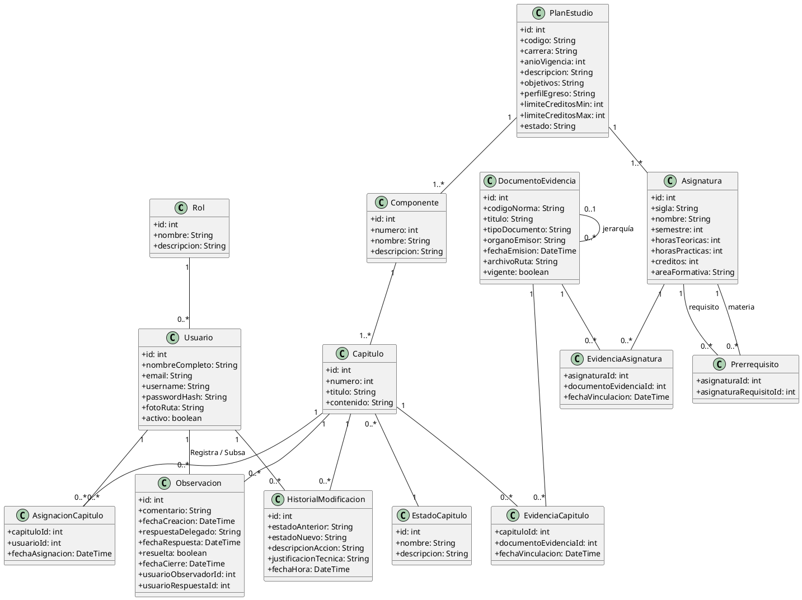

# 01. Diagrama de Clases y Modelo de Dominio

Este documento describe el modelo de dominio para el sistema **Seguimiento al Diseño Curricular**, diseñado para operar mediante interacción por correo electrónico (POP3/SMTP) y base de datos PostgreSQL.

---

## 1. Diagrama de Clases (PlantUML)

---

## 2. Diccionario de Clases y Responsabilidades

### Módulo 1: Malla Curricular y Estructura
* **`Rol`:** Tipificación de permisos de usuario (`Director`, `Delegado`, `Invitado`).
* **`Usuario`:** Actores que interactúan con el sistema mediante comandos de email. Incluye ruta o URL a fotografía (`fotoRuta`).
* **`PlanEstudio`:** Representa un plan curricular (código, año, objetivos formativos, perfil de egreso y límites de créditos).
* **`Asignatura`:** Materias que conforman la malla de un plan (sigla, semestre, carga horaria y créditos).
* **`Prerrequisito`:** Relación recursiva muchos a muchos sobre `Asignatura` para modelar el Grafo Acíclico Dirigido (DAG) de prelación.

### Módulo 2: Avance del Rediseño
* **`Componente`:** Secciones temáticas del marco curricular (ej. Componente Filosófico, Pedagógico, de Gestión) que agrupan capítulos correlativos (RF-05).
* **`EstadoCapitulo`:** Catálogo inmutable de estados de la máquina de estados: `Borrador`, `En Revisión`, `Observado` y `Aprobado` (RF-06).
* **`Capitulo`:** Unidad documental redactada y evaluada.
* **`AsignacionCapitulo`:** Vínculo de responsabilidad que asigna redactores/delegados a cada capítulo (RF-05).
* **`Observacion`:** Registro de señalamientos de autoridades y subsanaciones de delegados (RF-08).
* **`HistorialModificacion`:** Pista de auditoría inmutable que registra cada cambio de estado con fecha, hora, usuario y justificación técnica (RF-10).

### Módulo 3: Evidencias y Compilación
* **`DocumentoEvidencia`:** Archivos PDF/resoluciones normativas de respaldo. Posee autorreferencia para representar jerarquías normativas (RF-11, RF-12).
* **`EvidenciaCapitulo`:** Vínculo mandatorio que adjunta respaldos a un capítulo para permitir su aprobación (RF-07, RF-13).
* **`EvidenciaAsignatura`:** Respaldo normativo específico asociado a la creación o modificación de una asignatura.
