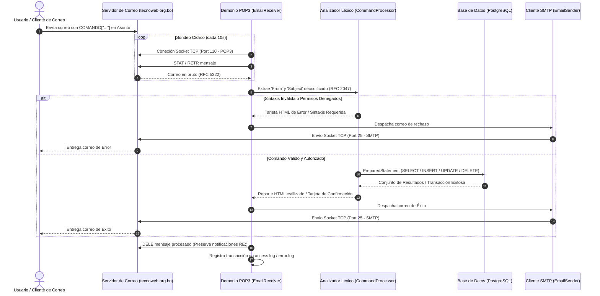

# Sistema de Seguimiento al Diseño Curricular Basado en Correo Electrónico (Email-Driven Architecture)

**Universidad Autónoma Gabriel René Moreno (UAGRM)**  
**Facultad de Ingeniería en Ciencias de la Computación y Telecomunicaciones (FICCT)**  
**Materia:** INF513 - Tecnología Web  
**Docente:** Ing. Evans Balcázar  
**Gestión:** 2026-2  
**Grupo:** 02 SA  

---

## 1. Descripción del Proyecto

El **Sistema de Seguimiento al Diseño Curricular** es un backend descentralizado basado en una **Arquitectura Guiada por Correo Electrónico (Email-Driven Architecture)**. El sistema permite a directores de carrera, delegados curriculares y docentes gestionar colaborativamente planes de estudio, mallas curriculares, componentes, redacción de capítulos, flujo de aprobación por máquina de estados, subsanación de observaciones, vinculación de evidencias normativas y compilación de reportes ejecutivos.

La interacción entre los clientes y el sistema se realiza **exclusivamente a través de comandos estructurados enviados en el Asunto (Subject)** de los correos electrónicos, utilizando protocolos de red estándar a bajo nivel (**POP3** en puerto 110 y **SMTP** en puerto 25) mediante Sockets TCP puros en Java, interactuando con un motor de base de datos relacional **PostgreSQL**.

---

## 2. Infraestructura Oficial y Control de Versiones

Conforme a las especificaciones de infraestructura provistas por la cátedra para el Grupo 02 SA:

* **Control de Versiones (GitHub):** [https://github.com/Luis-ecv/Email-TW-P1](https://github.com/Luis-ecv/Email-TW-P1)
* **Servidor Web Oficial de Cátedra:** [https://www.tecnoweb.org.bo/inf513/grupo02sa](https://www.tecnoweb.org.bo/inf513/grupo02sa)
* **Servidor de Correo Electrónico:** `grupo02sa@tecnoweb.org.bo`
  - Protocolo de Recepción: **POP3** (Puerto 110)
  - Protocolo de Envío: **SMTP** (Puerto 25)
* **Gestor de Base de Datos:** PostgreSQL en `db.tecnoweb.org.bo` (Host: `139.99.68.169`, Puerto: `5432`)
  - **Base de Datos Asignada:** `db_grupo02sa`
  - **Usuario:** `grupo02sa`
  - **Contraseña:** `grup002grup002*`

---

## 3. Arquitectura y Ciclo de Vida del Sistema

### Diagrama de Secuencia del Flujo Operativo (Mermaid)



### Diagrama de Bloques de la Arquitectura (ASCII)

```text
+-------------------------------------------------------------------------+
|                          CLIENTE REMITENTE                              |
|          Envia Subject: COMANDO["param1", "param2", ...]               |
+------------------------------------+------------------------------------+
                                     |  (SMTP Port 25 / 587)
                                     v
+-------------------------------------------------------------------------+
|                   SERVIDOR DE CORREO (tecnoweb.org.bo)                  |
|                        Casilla: grupo02sa@tecnoweb.org.bo               |
+------------------------------------+------------------------------------+
                                     |  (POP3 Socket TCP Port 110)
                                     v
+-------------------------------------------------------------------------+
|                  DEMONIO RECEPTOR (EmailReceiver.java)                  |
|   - Sondeo periódico (Polling cada 10s)                                 |
|   - Soporte MIME RFC 2047 (UTF-8, Base64, Quoted-Printable)              |
|   - Filtro anti-bucles (descarta autorepuestas 'RE:')                    |
+------------------------------------+------------------------------------+
                                     |
                                     v
+-------------------------------------------------------------------------+
|                 ANALIZADOR Y PROCESADOR (CommandProcessor)              |
|   - Extracción de parámetros: PARAM_PATTERN regex tolerante             |
|   - Control de Acceso Basado en Roles (RBAC: Director, Delegado, Docente)|
|   - Validación estricta de tipos de datos (int, date, boolean, password)|
+-------------------+---------------------------------+-------------------+
                    |                                 |
           (Sentencia Válida)                (Fallo de Validación / SQL)
                    |                                 |
                    v                                 v
+-----------------------------------+   +---------------------------------+
|   CAPA DAO (PreparedStatements)   |   |   REGISTRO EN DISCO             |
|   - 10 DAOs especializados        |   |   - error.log (trazas de error) |
|   - Prevención SQL Injection      |   |   - access.log (auditoría)      |
+-------------------+---------------+   +---------------------------------+
                    |
                    v
+-------------------------------------------------------------------------+
|              MOTOR DE BASE DE DATOS (PostgreSQL 16)                     |
|                   Base de datos: db_grupo02sa                           |
|                   14 Tablas Relacionales del Dominio                    |
+------------------------------------+------------------------------------+
                                     |
                                     v
+-------------------------------------------------------------------------+
|                   CLIENTE SMTP (EmailSender.java)                       |
|   - Sockets TCP puros en Puerto 25                                      |
|   - Mensajes multiparte con Content-ID (CID) para fotos e infografías   |
|   - Respuestas enriquecidas con HTML responsivo institucional           |
+------------------------------------+------------------------------------+
                                     |
                                     v
+-------------------------------------------------------------------------+
|                        BUZÓN DEL CLIENTE (Retorno)                      |
|                  Recibe confirmación gráfica de Éxito o Error           |
+-------------------------------------------------------------------------+
```

---

## 4. Diagrama de Flujo del Analizador Léxico y Validador (Parser)

```text
      [Mensaje recibido de POP3]
                 │
                 ▼
     ¿El remitente está vacío? ────► (SÍ) ──► Descartar mensaje
                 │ (NO)
                 ▼
     ¿Asunto inicia con 'RE:'? ────► (SÍ) ──► Preservar en buzón (sin borrar)
                 │ (NO)
                 ▼
        ¿Es comando 'HELP'? ───────► (SÍ) ──► Responder Manual HTML
                 │ (NO)
                 ▼
        ¿Es comando 'LOGIN'? ──────► (SÍ) ──► Autenticar usuario y vincular
                 │ (NO)
                 ▼
     ¿Es comando público libre? ───► (SÍ) ──► Ejecutar consulta directamente
    (LISPLA, LISASIG, VERGRAFO)
                 │ (NO)
                 ▼
     ¿Remitente existe en BD? ─────► (NO) ──► Error 401: Remitente no registrado
                 │ (SÍ)
                 ▼
     ¿El rol tiene autorización? ──► (NO) ──► Error 403: Permiso Denegado por Rol
                 │ (SÍ)
                 ▼
   ¿Regex valida estructura [...]? ─► (NO) ──► Error 400: Error de Sintaxis
                 │ (SÍ)
                 ▼
   ¿Tipos de datos válidos? ───────► (NO) ──► Error 422: Parámetro Inválido
                 │ (SÍ)
                 ▼
    Ejecutar PreparedStatement SQL
                 │
        ┌────────┴────────┐
        ▼                 ▼
   [Éxito SQL]       [Excepción SQL / Integridad]
        │                 │
        ▼                 ▼
  Generar HTML      Generar Tarjeta
  de Resultados     de Error con Detalle
        │                 │
        └────────┬────────┘
                 ▼
     Despachar SMTP al Cliente
                 │
                 ▼
  Registrar en access.log / error.log
                 │
                 ▼
    Eliminar comando de POP3 (DELE)
```

---

## 5. Estructura de la Base de Datos Relacional

La base de datos relacional reside en **PostgreSQL** (`db_grupo02sa`) y contiene **14 tablas** diseñadas para soportar la gestión curricular integral:

| # | Tabla | Descripción del Dominio | Columnas Principales |
|---|---|---|---|
| 1 | `rol` | Roles institucionales del sistema. | `id`, `nombre`, `descripcion` |
| 2 | `usuario` | Cuentas autorizadas, remitentes y credenciales. | `id`, `nombre_completo`, `email`, `username`, `password`, `foto_ruta`, `activo`, `id_rol` |
| 3 | `plan_estudio` | Programas de estudio curricular (carreras). | `id`, `codigo`, `carrera`, `anio_vigencia`, `descripcion`, `objetivos`, `perfil_egreso`, `limite_creditos_min`, `limite_creditos_max`, `estado` |
| 4 | `asignatura` | Materias asociadas a cada plan de estudio. | `id`, `sigla`, `nombre`, `semestre`, `horas_teoricas`, `horas_practicas`, `creditos`, `area_formativa`, `id_plan_estudio` |
| 5 | `prerrequisito` | Grafo dirigido de dependencias de la malla. | `id_asignatura`, `id_asignatura_requisito` |
| 6 | `componente` | Grandes secciones curriculares de un plan. | `id`, `numero`, `nombre`, `descripcion`, `id_plan_estudio` |
| 7 | `estado_capitulo` | Catálogo de la máquina de estados. | `id`, `nombre` (*Borrador*, *En Revisión*, *Observado*, *Aprobado*) |
| 8 | `capitulo` | Capítulos y contenidos técnicos formales. | `id`, `numero`, `titulo`, `contenido`, `id_componente`, `id_estado` |
| 9 | `asignacion_capitulo` | Asignación de docentes redactores a capítulos. | `id_capitulo`, `id_usuario`, `fecha_asignacion` |
| 10 | `observacion` | Observaciones técnicas y subsanaciones formales. | `id`, `comentario`, `respuesta_delegado`, `fecha_respuesta`, `resuelta`, `fecha_cierre`, `id_capitulo`, `id_usuario_observador`, `id_usuario_respuesta` |
| 11 | `historial_modificacion`| Pista de auditoría completa de cambios. | `id`, `estado_anterior`, `estado_nuevo`, `descripcion_accion`, `justificacion_tecnica`, `fecha_hora`, `id_capitulo`, `id_usuario` |
| 12 | `documento_evidencia`| Repositorio digital de normas y resoluciones. | `id`, `codigo_norma`, `titulo`, `tipo_documento`, `organo_emisor`, `fecha_emision`, `archivo_ruta`, `vigente`, `id_documento_padre` |
| 13 | `evidencia_capitulo` | Vinculación N:M de evidencias con capítulos. | `id_capitulo`, `id_documento_evidencia`, `fecha_vinculacion` |
| 14 | `evidencia_asignatura`| Vinculación N:M de evidencias con materias. | `id_asignatura`, `id_documento_evidencia`, `fecha_vinculacion` |

---

## 6. Catálogo Completo de Comandos (39 Comandos)

El sistema procesa los 8 Casos de Uso (CU1 a CU8) y 15 Requisitos Funcionales mediante la siguiente matriz de comandos:

### Comandos Generales y de Autenticación
* `HELP["*"]`: Muestra el manual de usuario interactivo con ejemplos y catálogo. *(Público)*
* `LOGIN["email", "password"]`: Valida credenciales contra la BD y muestra el perfil institucional. *(Público)*

### CU1: Gestión de Usuarios y Roles
* `LISUSU["*"]`: Lista usuarios con avatares dinámicos (iniciales + color de rol) y enlaces a foto.
* `INSUSU["Nombre", "email", "username", "password", "idRol", "fotoRuta"]`: Registra un nuevo usuario con validación estricta de contraseña y despacho de credenciales por email. *(Director)*
* `UPDUSU["id", "Nombre", "email", "username", "password", "idRol", "fotoRuta", "activo"]`: Actualiza los datos de un usuario. *(Director)*
* `DELUSU["id"]`: Desactiva / elimina un usuario del sistema. *(Director)*

### CU2: Gestión de Planes de Estudio
* `LISPLA["*"]`: Catálogo de planes de estudio vigentes y en diseño. *(Público)*
* `INSPLA["codigo", "carrera", "anio", "descripcion", "objetivos", "perfil", "minCred", "maxCred"]`: Registra nuevo plan. *(Director)*
* `UPDPLA["id", "codigo", "carrera", "anio", "descripcion", "objetivos", "perfil", "minCred", "maxCred", "estado"]`: Actualiza plan. *(Director)*

### CU3: Malla Curricular y Prerrequisitos
* `LISASIG["idPlan"]`: Lista materias del plan especificado (o todas si se omite). *(Público)*
* `INSASIG["sigla", "nombre", "semestre", "ht", "hp", "creditos", "area", "idPlan"]`: Registra asignatura en la malla.
* `UPDASIG["id", "sigla", "nombre", "semestre", "ht", "hp", "creditos", "area"]`: Actualiza datos de una materia.
* `DELASIG["id"]`: Elimina materia previa verificación de dependencias.
* `INSPRE["idAsig", "idReq"]`: Enlaza prerrequisito con validación matemática de ciclos y semestres.
* `DELPRE["idAsig", "idReq"]`: Elimina prerrequisito.
* `LISPRE["idAsig"]`: Lista prerrequisitos directos de una materia.
* `VERGRAFO["idAsig"]`: Visualiza el árbol genealógico completo de dependencias hacia atrás y adelante. *(Público)*

### CU4: Componentes y Capítulos Curriculares
* `LISCOM["idPlan"]`: Lista los componentes estructurales de un plan de estudios.
* `INSCOM["numero", "nombre", "descripcion", "idPlan"]`: Registra componente curricular.
* `LISCAP["idComponente"]`: Lista capítulos con estado de aprobación y redactores asignados.
* `INSCAP["numero", "titulo", "contenido", "idComponente"]`: Crea capítulo en estado *Borrador*.
* `UPDCAP["id", "numero", "titulo", "contenido", "idComponente"]`: Actualiza contenido técnico del capítulo.
* `DELCAP["id"]`: Elimina capítulo.
* `ASIGCAP["idCapitulo", "idUsuario"]`: Asigna docente redactor a un capítulo.
* `DELASIGCAP["idCapitulo", "idUsuario"]`: Remueve redactor asignado.

### CU5: Máquina de Estados y Auditoría
* `CAMBESTADO["idCapitulo", "nuevoEstado", "justificacion", "idUsuario"]`: Transiciona el estado del capítulo (*Borrador* ➔ *En Revisión* ➔ *Observado* / *Aprobado*). Impide la aprobación si existen observaciones pendientes o carece de documentos de evidencia. Registra en historial.

### CU6: Observaciones y Subsanaciones
* `INSOBS["idCapitulo", "comentario", "idUsuarioObservador"]`: Registra observación técnica y transiciona automáticamente el capítulo a estado *Observado*.
* `SUBSANOBS["idObs", "respuestaTecnica", "idDelegado"]`: Subsana observación y marca fecha de cierre.
* `LISOBS["idCapitulo"]`: Lista observaciones detallando resueltas y pendientes.
* `LISHIST["idCapitulo"]`: Muestra la bitácora y pista de auditoría completa de modificaciones.

### CU7: Repositorio Digital de Evidencias Normativas
* `INSDOC["codigoNorma", "titulo", "tipo", "emisor", "fecha", "archivoRuta", "idPadre"]`: Registra resolución, decreto o normativa de respaldo.
* `LISDOC["idCapitulo"]`: Lista evidencias globales o vinculadas a un capítulo específico.
* `VINCULEVI["idCapitulo", "idDocumento"]`: Vincula documento normativo como respaldo del capítulo.
* `DELVINCULEVI["idCapitulo", "idDocumento"]`: Desvincula documento de un capítulo.
* `BUSDOC["criterio", "valor"]`: Búsqueda facetada por `TIPO`, `EMISOR`, `CODIGO`, `CAPITULO` o `VIGENTE`.

### CU8: Monitoreo, Estadísticas y Reporte Final
* `VERDASH["*"]`: Tablero de control ejecutivo con porcentajes de avance, métricas y alertas.
* `REPORTEFINAL["idPlan"]`: Compilador oficial curricular que consolida la malla, capítulos aprobados y resoluciones vigentes.
* `REPAVANCE["*"]`: Estadísticas de avance porcentual desglosadas por componente curricular.
* `REPUSUARIOS["*"]`: Auditoría de participación de usuarios (capítulos asignados y observaciones).

---

## 7. Requisitos Técnicos y Buenas Prácticas de Ingeniería

Para garantizar la calidad técnica y la robustez del desarrollo conforme a los lineamientos de la materia:

### 1. Seguridad Informática Relacional
* **Mitigación Total de Inyección SQL:** El sistema utiliza sentencias preparadas (`PreparedStatement`) en el 100% de las operaciones de base de datos (65 sentencias validadas en 10 DAOs), eliminando cualquier riesgo de interpolación directa de parámetros en las cadenas SQL.
* **Validación Tipada y Previa en Servidor:** Todos los parámetros recibidos en el Asunto son convertidos y validados con tipos estrictos (`parseEntero`, `parseFecha`, `Boolean.parseBoolean` y validación de contraseñas seguras) antes de ser enviados a la capa de persistencia.

### 2. Robustez en el Parsing
* **Soporte MIME Completo (RFC 2047):** Decodificación transparente mediante `MimeUtility.decodeText()` para asuntos codificados en UTF-8, Base64 o Quoted-Printable (tildes, eñes y caracteres especiales).
* **Subject Folding (RFC 5322):** Soporte de asuntos divididos en múltiples líneas con tabulaciones o espacios en blanco continuos.
* **Analizador Léxico Tolerante:** La expresión regular `PARAM_PATTERN` procesa parámetros con comillas dobles, comillas simples o cadenas no entrecomilladas, suprimiendo espacios en blanco residuales.

### 3. Manejo de Excepciones y Logging
* Registro thread-safe en disco de dos archivos de auditoría técnica:
  - **`access.log`:** Remitente, comando ejecutado, estado del resultado y tiempo de respuesta en milisegundos.
  - **`error.log`:** Trazas detalladas de excepciones SQL, fallos de parámetros o accesos denegados por rol.
* Los archivos `.log` se encuentran excluidos del repositorio mediante `.gitignore` para no versionar datos locales.

---

## 8. Sistema de Auditoría y Archivos de Log

El sistema genera automáticamente dos archivos de registro en disco:

1. **`access.log`:** Registra cada transacción entrante, remitente, comando ejecutado, estado final y duración en milisegundos.
   ```text
   [2026-11-20 07:38:15] [ACCESS] Remitente: croca@uagrm.edu.bo | Comando: LISCAP["1"] | Estado: OK | Duración: 142ms
   ```
2. **`error.log`:** Registra rechazos por falta de permisos de rol, errores de sintaxis en los parámetros, fallos de conexión o excepciones SQL con traza completa.
   ```text
   [2026-11-20 07:38:40] [ERROR] Remitente: docente@uagrm.edu.bo | Comando: INSPLA[...] | Mensaje: Acceso denegado o permisos insuficientes por rol
   ```

Para monitorear en vivo durante la defensa:
```bash
tail -f access.log
tail -f error.log
```

---

## 9. Instrucciones de Instalación y Ejecución

### Prerrequisitos
* **Java Development Kit (JDK):** Versión 17 o superior.
* **Apache Maven:** Versión 3.8 o superior.
* **Conectividad a Red:** Acceso a los puertos 110 (POP3), 25 (SMTP) y 5432 (PostgreSQL) del servidor `tecnoweb.org.bo`.

### Configuración de Parámetros (`Config.java`)
Los parámetros de conexión se encuentran configurados por defecto para el laboratorio de la facultad, pero pueden sobreescribirse mediante variables de entorno:

| Variable | Descripción | Valor por Defecto |
|---|---|---|
| `MAIL_HOST` | Host del servidor de correo | `139.99.68.169` |
| `POP3_PORT` | Puerto de lectura POP3 | `110` |
| `SMTP_PORT` | Puerto de despacho SMTP | `25` |
| `MAIL_USER` | Usuario de la casilla de correo | `grupo02sa` |
| `MAIL_PASSWORD` | Contraseña de la casilla | `grup002grup002*` |
| `MAIL_EMAIL` | Dirección de correo asignada | `grupo02sa@tecnoweb.org.bo` |
| `DB_HOST` | Servidor PostgreSQL | `139.99.68.169` |
| `DB_PORT` | Puerto PostgreSQL | `5432` |
| `DB_NAME` | Nombre de la base de datos | `db_grupo02sa` |
| `DB_USER` | Usuario de base de datos | `grupo02sa` |
| `DB_PASSWORD` | Contraseña de base de datos | `grup002grup002*` |
| `POP3_POLL_INTERVAL_MS`| Frecuencia de sondeo | `10000` (10 segundos) |

### Compilación y Ejecución del Demonio

1. **Compilar el proyecto:**
   ```bash
   mvn clean compile
   ```

2. **Ejecutar el servicio demonio de correo:**
   ```bash
   mvn exec:java -Dexec.mainClass="com.curriculo.Main"
   ```

3. **Verificación en consola:**
   ```text
   =================================================================
     SISTEMA DE SEGUIMIENTO AL DISEÑO CURRICULAR (VIA EMAIL)
     Grupo 02 SA - TecnoWeb UAGRM
   =================================================================
   Servidor de Correo : 139.99.68.169
   Buzón de Escucha   : grupo02sa@tecnoweb.org.bo
   Base de Datos      : 139.99.68.169:5432/db_grupo02sa
   Intervalo Sondeo   : 10 segundos
   =================================================================
   Iniciando servicio de escucha de correos...
   EmailReceiver iniciado. Escuchando en: grupo02sa@tecnoweb.org.bo
   Servicio activo y a la espera de nuevos comandos.
   ```
